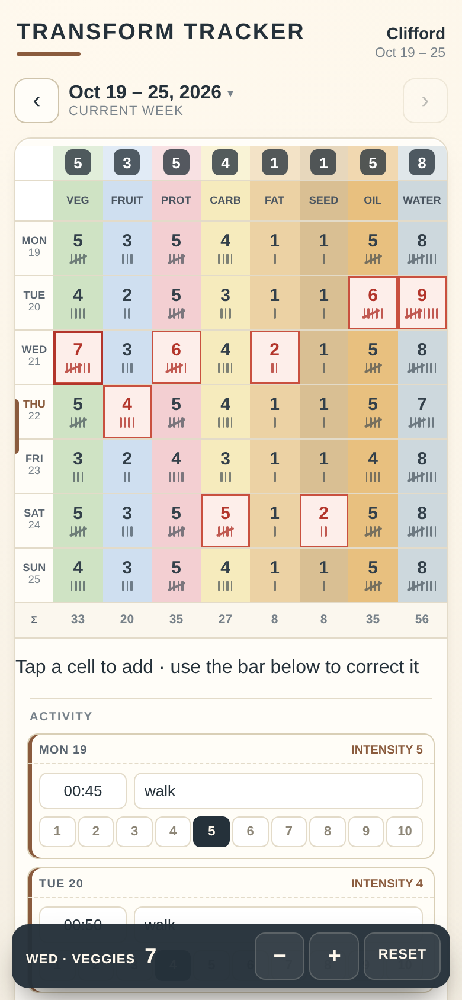

# Transform Tracker

A mobile-first weekly tracker for the paper form it replaces: eight food columns
of tally marks, a per-day activity log, and start/end weight + waist.

Weeks roll over on Monday by themselves, old weeks stay browsable, and each new
week carries your goals and your opening measurements forward.

FastAPI + SQLite + a no-build vanilla front-end. One process, one file of state,
no accounts.



## What it does

- **8 × 7 tally grid** — Veggies, Fruits, Protein, Carbs, Fats, Seeds, Oils + Nuts,
  Water, each with its own colour and a daily goal (1–9) you can change any time.
- **Tally cells** — tap to add one; a bar slides up naming that cell with `−`,
  `+` and `Reset`. Cells over their goal turn red.
- **Activity per day** — time (`HH:MM`), type, and an intensity of 1–10.
- **Measurements** — opening/closing weight and waist, with the delta shown.
- **Week navigation** — backwards only (it's a planner, not a forecast), plus a
  week picker. Past weeks are read-only until you unlock them.
- **Reminders** — Telegram or any webhook, at meal times, only when the day is
  still blank.
- **A JSON API for everything** — plus a CSV export.

## Quick start

```bash
git clone https://github.com/SartorialGrunt0/transform-tracker.git
cd transform-tracker
./scripts/dev.sh                      # http://localhost:8088
```

That creates a venv, installs the deps, and runs against
`~/.transform-tracker/tracker.db`. Point it somewhere else with `TT_DB`:

```bash
TT_DB=./data/dev.db ./scripts/dev.sh
TT_DB=./data/dev.db .venv/bin/python scripts/seed_demo.py   # optional demo week
```

## Docker

The image is `python:3.13-slim` + uvicorn, one worker, with a `/healthz`
healthcheck. The SQLite file is the only state.

```bash
docker compose up -d --build
curl http://localhost:8088/healthz     # {"ok":true}
```

`docker-compose.yml` in this repo is the example — copy it and change what you
need:

```yaml
services:
  transform-tracker:
    build: .
    container_name: transform-tracker
    restart: unless-stopped
    ports:
      - "8088:8088"          # host:container — change the left side only
    environment:
      TZ: America/Los_Angeles
      TT_DB: /data/tracker.db
    volumes:
      - ./data:/data         # the database lives here; keep it out of git
```

Everyday commands:

```bash
docker compose logs -f               # follow logs
docker compose restart               # restart, data survives
docker compose down                  # stop + remove the container, ./data stays
docker compose up -d --build         # rebuild after a git pull
```

The container starts as root and writes to `/data`; if you'd rather it didn't,
add `user: "1000:1000"` and make sure `./data` is owned by that uid.

### Environment

| Variable | Default | Purpose |
| --- | --- | --- |
| `TT_DB` | `~/.transform-tracker/tracker.db` (`/data/tracker.db` in Docker) | SQLite file |
| `TT_HOST` | `0.0.0.0` | bind address |
| `TT_PORT` | `8088` | port uvicorn listens on |
| `TT_TICK` | `60` | seconds between reminder-scheduler ticks |
| `TT_RELOAD` | unset | `1`/`true` enables uvicorn auto-reload (dev only) |
| `TZ` | container default | clock for logs; week boundaries use the app's own setting |

Everything user-facing (name, reminder times, Telegram token, webhook) lives in
the app's **Reminders & settings** dialog and is stored in the database, not in
env vars.

### Behind a reverse proxy

Nothing special: the app is plain HTTP on one port with no WebSockets. Point
nginx/Caddy/Traefik at `http://<host>:8088` and forward the `Host` header. There
is no authentication — keep it on your LAN or put auth in front of it.

## Backup and restore

SQLite in WAL mode; copy it with `.backup`, not `cp`:

```bash
# host, with the sqlite3 CLI installed
sqlite3 data/tracker.db ".backup 'data/tracker-$(date +%F).db'"

# or through the container
docker exec transform-tracker python -c \
  "import sqlite3;s=sqlite3.connect('/data/tracker.db');d=sqlite3.connect('/data/backup-$(date +%F).db');s.backup(d);d.close();s.close()"
```

Restore: `docker compose down`, replace `data/tracker.db` with the backup, then
`docker compose up -d`.

`data/`, `*.db`, `backups/` and `.env*` are git-ignored — your numbers and tokens
never end up in a commit.

## How the week works

- The current week is the Monday–Sunday containing today, in the configured
  timezone. You can only move **backwards**; future weeks are not open.
- Opening a week for the first time creates it and carries forward your name,
  the eight goals, and *opening* weight/waist = last week's *closing* numbers.
  Tallies and activity start empty.
- Weeks before the current one are **locked** (read-only). Each has an Unlock
  button for corrections and a Lock button to close it again.
- A cell turns red when its count exceeds that column's goal.

## Using it

The week grid is the whole app: eight columns × seven days, the plan goals on
top, that week's activity underneath, then the weight/waist bookends.

| Action | Effect |
| --- | --- |
| tap a cell | +1 |
| `−` / `+` in the bar | −1 / +1 |
| `Reset` | back to zero |
| tap a goal number | change that column's goal (1–9) |
| `‹` / week label | previous week / jump to any stored week |

There are no zoom levels or gestures to learn: tapping a cell raises a bar that
names it (`WED · VEGGIES 7`), and the tapped cell is outlined so it's always
obvious what you're editing.

## API

Everything the UI does is a plain JSON endpoint, so anything else can drive it.

| Method | Path | Purpose |
| --- | --- | --- |
| GET | `/api/bootstrap` | today, current week, settings, full week payload |
| GET | `/api/week/{week}` | one week (`YYYY-MM-DD` inside the week, or `current`) |
| GET | `/api/weeks` | every stored week, newest first |
| POST | `/api/week/{week}/cell` | `{day, col, delta}` → `{count, over}` |
| PUT | `/api/week/{week}/cell` | `{day, col, count}` |
| PUT | `/api/week/{week}/activity` | `{day, time:"HH:MM", type, intensity:1-10}` |
| PATCH | `/api/week/{week}` | `{goals:{col:n}, name, weight_start, weight_end, waist_start, waist_end}` |
| POST | `/api/week/{week}/unlock` | `{unlocked:true|false}` |
| GET/PUT | `/api/settings` | reminder + name config |
| POST | `/api/notify/test` | send one test push |
| GET | `/api/reminders/due[?consume=true]` | reminders owed right now |
| POST | `/api/reminders/ack` | `{day, slot, kind}` mark as sent |
| GET | `/api/export.csv` | every week, one row per day |
| GET | `/healthz` | liveness probe |

`day` is 0 = Monday … 6 = Sunday. Status codes: `400` bad input, `422` future
week, `423` locked week.

Examples:

```bash
# add a tally (day 2 = Wednesday, water)
curl -sX POST localhost:8088/api/week/current/cell \
  -H 'Content-Type: application/json' -d '{"day":2,"col":"water","delta":1}'

# set it outright
curl -sX PUT localhost:8088/api/week/current/cell \
  -H 'Content-Type: application/json' -d '{"day":2,"col":"water","count":6}'

# what's owed right now, marking it sent
curl -s "localhost:8088/api/reminders/due?consume=true"
```

## Reminders

Two triggers, both only firing when the day is still blank:

- **Meal times** — if nothing at all is tallied for today.
- **Evening nudge** — if today's activity (time/type) is empty.

Each slot is sent at most once per day (deduped in the `reminders` table).

**Telegram:** message [@BotFather](https://t.me/BotFather) → `/newbot` → copy the
token → send the bot any message → open
`https://api.telegram.org/bot<token>/getUpdates` and copy `chat.id` → paste both
into *Reminders & settings* → **Send test**.

**Webhook:** set any URL and the app POSTs `{"text": "..."}` to it. Point a Hermes
cronjob or anything else at `GET /api/reminders/due?consume=true` if you'd rather
push from outside — `consume=true` marks them sent so nothing repeats.

## Development

```bash
python -m pytest -q          # 20 API tests
ruff check --select=F,E,W app tests scripts
```

Layout:

```
app/main.py        FastAPI routes + scheduler loop
app/domain.py      weeks, goals, tallies, validation (no I/O)
app/db.py          SQLite schema + queries
app/reminders.py   reminder rules + Telegram/webhook delivery
app/static/        index.html, styles.css, app.js (no build step)
scripts/dev.sh     venv + run
scripts/seed_demo.py  demo week for screenshots
```

## Notes

- No auth by design. LAN only, or put a proxy with auth in front.
- Weight/waist ranges are weight 40–700, waist 10–120; goals are 1–9.
- The scheduler wakes every 60 s (`TT_TICK` overrides that for testing).

## Licence

GPL-3.0 — see [LICENSE](LICENSE).
